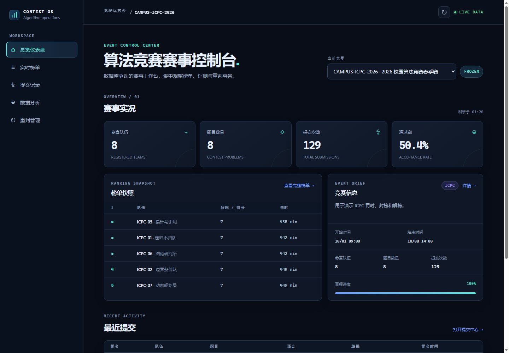

# Contest OS

FAFU算法竞赛赛事管理与榜单分析系统，使用 SQL Server 2022、ASP.NET Core 8 和原生 JavaScript。数据库负责赛事规则、成绩聚合及重判事务，Web 页面提供查询和操作入口。



## 功能

- ICPC 榜单按解题数、罚时和最后通过时间排序；IOI 榜单汇总每道题的最高分。
- 公开榜与裁判榜分别查询，封榜期间按提交时间过滤公开成绩。
- 提交记录支持队伍、题目及结果筛选，可查看同一提交的多个评测版本。
- 重判按竞赛、题目或队伍选择范围，在一个事务中登记批次、替换有效版本并保留历史；支持失败回滚验证。
- 统计页面展示题目通过率、队伍表现、语言分布及评测结果分布。

当前版本用于本地运行和数据库业务验证。评测数据来自样例脚本，重判过程复制已有结果以验证版本切换；代码编译、沙箱执行和用户登录鉴权尚未接入。公开榜与裁判榜的切换属于展示功能。部署到多人使用的环境前，需要补充身份认证及操作权限校验。

## 运行环境

- Windows 与 SQL Server 2022。
- .NET 8 SDK。
- SSMS 或 `sqlcmd`，用于执行数据库脚本。
- 当前 Windows 账户具有目标 SQL Server 实例的访问及建库权限。

## 启动

从仓库根目录初始化数据库：

```powershell
powershell -NoProfile -ExecutionPolicy Bypass -File scripts/init-database.ps1
```

默认连接 `localhost`，创建 `AlgorithmContestDB`。如果同名数据库已存在，脚本会保留现有数据并退出。命名实例可以通过 `-ServerInstance '.\SQLEXPRESS'` 指定。

也可以在 SSMS 中依次执行 `00_reset.sql`、`01_schema.sql`、`03_objects.sql`、`02_seed.sql`。其中 `00_reset.sql` 会删除并重建同名数据库，仅在确定可以清空数据时执行。

随后启动 Web：

```powershell
dotnet restore web/AlgorithmContestWeb.csproj
dotnet build web/AlgorithmContestWeb.csproj --no-restore
dotnet run --project web/AlgorithmContestWeb.csproj --urls http://localhost:5075
```

浏览器访问 <http://localhost:5075>。`/api/health` 检查 Web 进程，`/api/contests` 可进一步检查数据库连接与赛事查询。

默认连接串使用 Windows 身份验证。连接其他实例时，可以在当前终端设置环境变量：

```powershell
$env:ConnectionStrings__AlgorithmContestDb = 'Server=.\SQLEXPRESS;Database=AlgorithmContestDB;Trusted_Connection=True;TrustServerCertificate=True;Encrypt=False'
```

含密码的连接串通过本地环境变量配置，保留仓库中的无密码示例配置。

## 数据库

数据库包含 11 张表、6 个视图、4 个存储过程、3 个触发器，以及 5 个显式创建的索引。主键和唯一约束还会创建对应索引。

| 脚本 | 用途 |
| --- | --- |
| `00_reset.sql` | 删除并重建数据库 |
| `01_schema.sql` | 表、主外键、唯一约束和检查约束 |
| `03_objects.sql` | 视图、索引、存储过程和触发器 |
| `02_seed.sql` | ICPC、IOI 和报名阶段的样例数据 |
| `04_tests.sql` | 14 项结构、规则及事务断言 |
| `05_performance.sql` | 增加 2500 条提交，对比复合索引前后的逻辑读 |
| `06_backup_restore.sql` | 完整备份、备份集校验及恢复命令示例 |

初始化和样例数据应按上表前四行的顺序执行。功能测试会写入测试记录；性能脚本适合在新初始化的样例库上执行一次，重复运行前应重新准备样例库。

```powershell
sqlcmd -S localhost -E -b -f 65001 -i database/04_tests.sql
sqlcmd -S localhost -E -b -f 65001 -i database/05_performance.sql
```

备份脚本使用 SQL Server 实例配置的备份目录，备份文件保存在数据库服务器所在机器。`RESTORE VERIFYONLY` 校验备份集；实际恢复命令由脚本输出，需核对目标数据库后另行执行。

## 目录

```text
database/       数据库结构、对象、样例与测试脚本
web/            ASP.NET Core API 与静态页面
scripts/        数据库初始化脚本
docs/           接口说明、数据库设计和图片
.github/        构建与 JavaScript 语法检查
```

接口参数见 [API 说明](docs/api.md)，表结构和规则职责见 [数据库设计](docs/database.md)。[系统架构图](docs/images/architecture.png)、[E-R 图](docs/images/er-diagram.png) 和 [移动端页面](docs/images/mobile.png) 位于 `docs/images/`。
