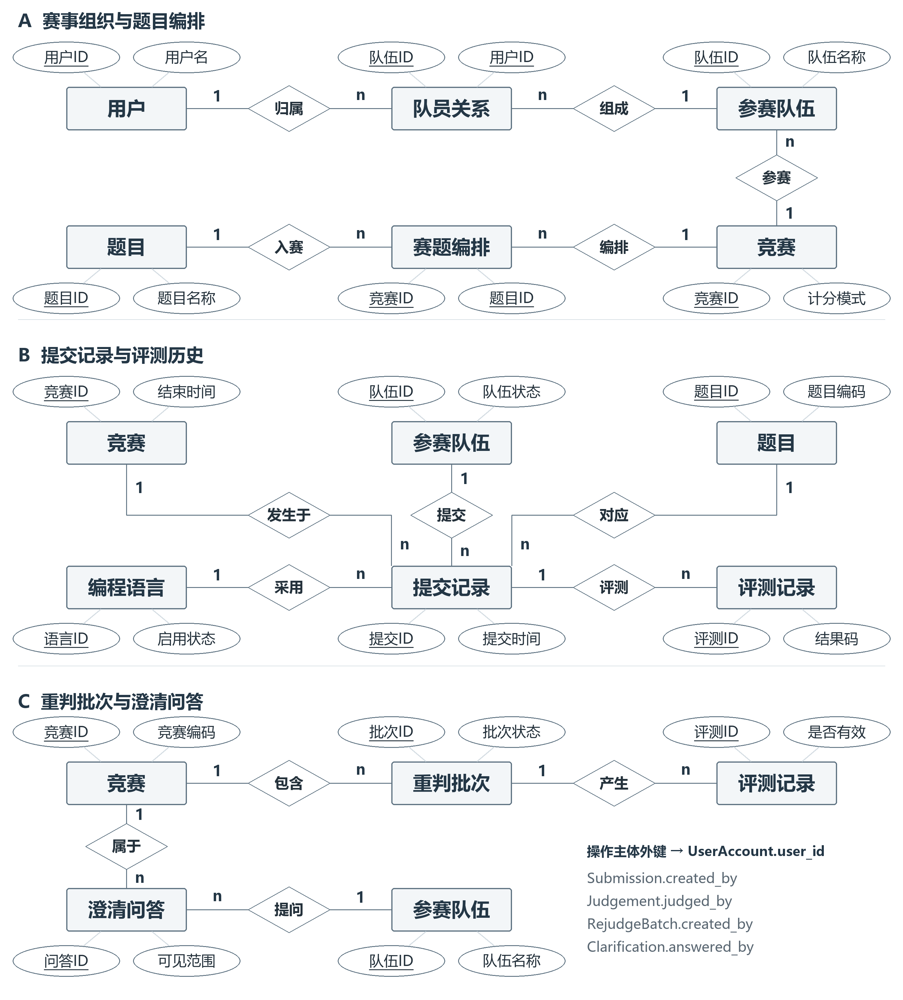

# 数据库设计

## 关系结构

| 表 | 保存的事实 |
| --- | --- |
| `UserAccount` | 用户名称、显示名称及业务角色 |
| `Contest` | 赛事计分模式、时间范围、封榜时间和状态 |
| `Team` | 某场赛事中的参赛队伍 |
| `TeamMember` | 队伍与成员的联系及成员角色 |
| `Problem` | 题目元数据 |
| `ContestProblem` | 赛事赛题编号、顺序、分值和资源限制 |
| `ProgrammingLanguage` | 语言及版本信息 |
| `Submission` | 一次提交的队伍、题目、时间和源码摘要 |
| `Judgement` | 一次评测的结果、得分、耗时和有效标志 |
| `RejudgeBatch` | 重判范围、原因、执行状态及操作人 |
| `Clarification` | 赛事答疑及回复记录 |

同一提交可以对应多个评测版本。`UX_Judgement_OneEffective` 是以 `is_effective=1` 为条件的过滤唯一索引，限制每次提交最多一条有效评测。排队中的提交可以暂时没有有效结果。

`TeamMember` 与 `ContestProblem` 分别保存成员关系和赛题编排。`Submission.contest_id` 为赛事筛选和榜单聚合保留冗余：`team_id` 已能决定赛事编号，因此该表存在严格第三范式的例外。提交校验触发器负责核对队伍所属赛事及赛题归属。

## 写入规则

| 对象 | 职责 |
| --- | --- |
| `usp_RegisterTeam` | 校验赛事状态并登记队伍及队长 |
| `usp_AddTeamMember` | 增加队员并检查现有成员关系 |
| `usp_SubmitAttempt` | 分配队内提交序号并写入提交记录 |
| `usp_ApplyRejudgeBatch` | 登记批次、替换有效评测、保留历史并处理失败回滚 |
| `trg_TeamMember_MaxThree` | 检查队伍成员数量及队长数量 |
| `trg_Submission_Validate` | 校验参赛队伍、赛题、赛事状态和提交时间 |
| `trg_Judgement_Validate` | 校验评测得分与计分模式等业务条件 |

外键约束负责引用存在性，唯一约束负责编号及组合键唯一性，CHECK 约束负责枚举值、时间顺序和数值范围。触发器补充跨表业务检查。

## 查询与索引

六个视图分别提供当前有效评测、完整评测历史、公开榜、裁判榜、题目统计和队伍统计。ICPC 与 IOI 共享提交及评测数据，按照各自规则聚合。

| 索引 | 用途 |
| --- | --- |
| `UX_Judgement_OneEffective` | 每次提交最多一个有效评测 |
| `IX_Submission_ContestTeamProblemTime` | 按赛事、队伍、题目和时间筛选提交 |
| `IX_Judgement_SubmissionEffective` | 查询提交对应的评测及有效标志 |
| `IX_RejudgeBatch_Status` | 按赛事和状态查询重判批次 |
| `IX_Clarification_ContestStatus` | 查询赛事答疑状态 |

`05_performance.sql` 使用相同筛选条件，在移除与重建目标复合索引后分别执行查询，记录 `STATISTICS IO/TIME`。比较时同时核对结果集，区分查询正确性和索引读取收益。

## 验证与备份

`04_tests.sql` 包含 14 项断言，检查对象存在、队员数量、非法提交、提交过程、重判回滚、历史保留及榜单查询。脚本在失败时抛出异常，便于通过 `sqlcmd -b` 获取失败退出码。

样例导入使用会话级 `SeedMode` 写入已结束赛事的历史数据，导入完成后清除该标记。应用账户的权限、会话上下文设置权限和真实赛事的管理操作需要在部署时进一步约束。

备份脚本从 SQL Server 实例读取默认备份目录，为每次备份生成带时间与随机后缀的文件名。`RESTORE VERIFYONLY` 检查备份集可读性；恢复后的业务一致性需要通过实际还原及重新运行查询确认。
