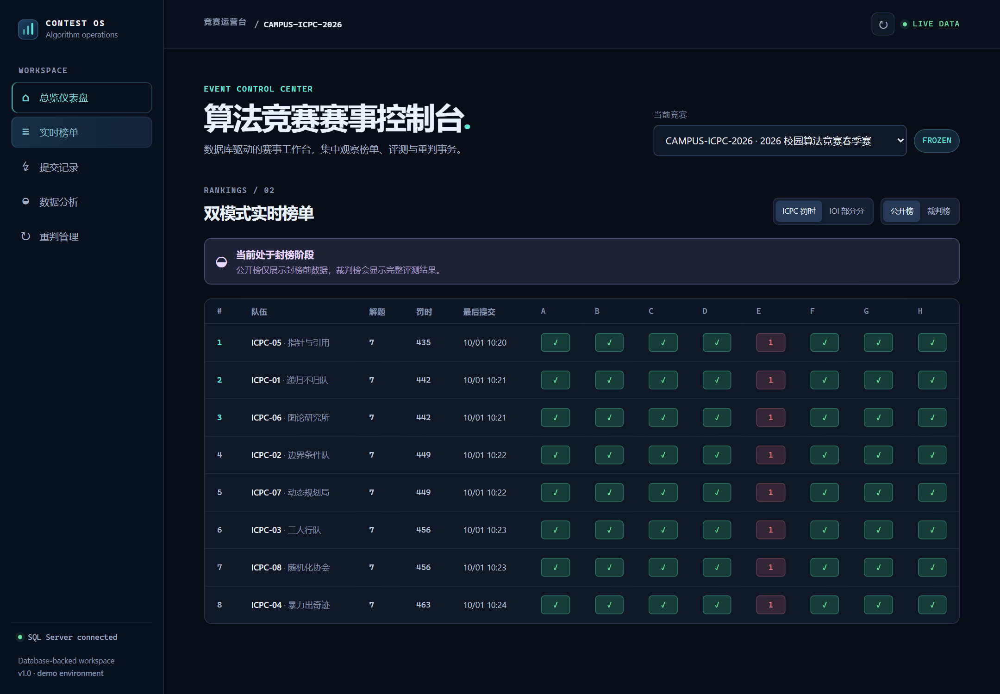
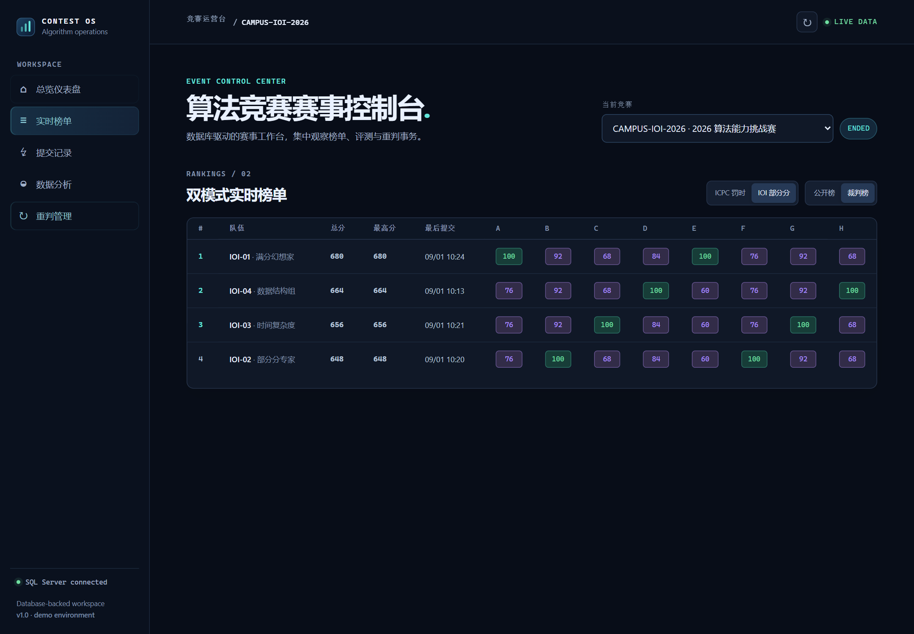
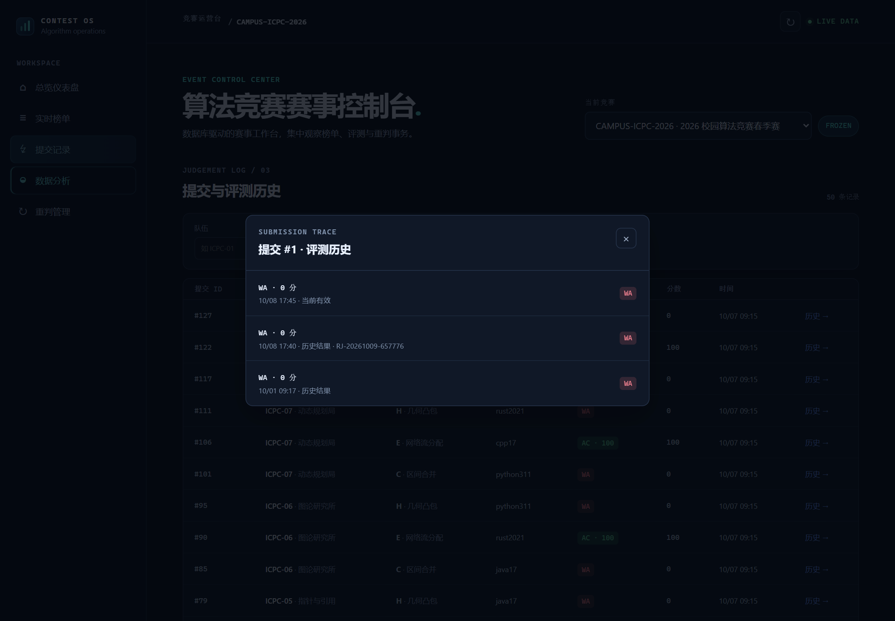
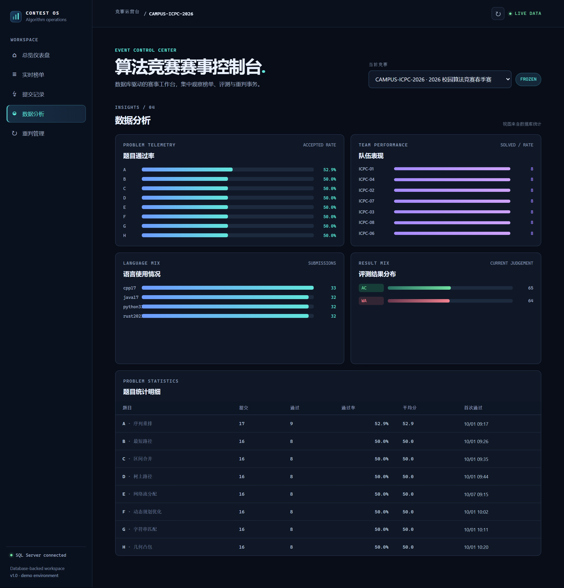
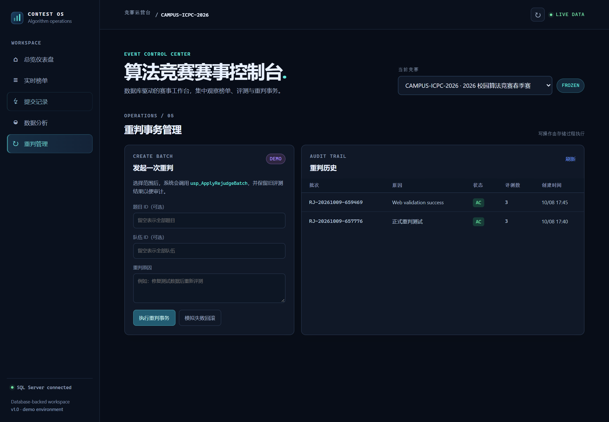

# 功能页面

截图对应本地样例库的一次验收状态。测试和重判操作会改变提交数量与评测版本，重新初始化样例库后的数字可能与截图不同。

| 截图 | 查看内容 |
| --- | --- |
| [overview.png](overview.png) | 赛事总览、汇总指标及榜单快照 |
| [scoreboard_public.png](scoreboard_public.png) | ICPC 公开榜与封榜提示 |
| [scoreboard_jury.png](scoreboard_jury.png) | 同一赛事的裁判榜及封榜后的成绩 |
| [scoreboard_ioi.png](scoreboard_ioi.png) | IOI 总分与每题最高分 |
| [history.png](history.png) | 同一提交的当前结果和历史评测 |
| [analytics.png](analytics.png) | 题目、队伍、语言及结果分布统计 |
| [rejudge.png](rejudge.png) | 重判表单、批次状态和审计记录 |

## ICPC 公开榜

## ICPC 裁判榜

## IOI 榜单

## 提交历史

## 数据分析

## 重判管理

